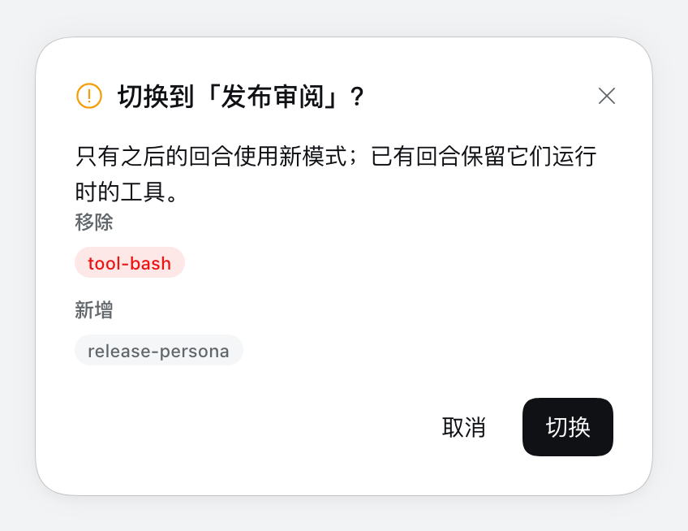

# dsh-preset-switch

[简体中文](README.zh.md)

Switch a session’s Agent preset while it is idle via the chevron beside the preset label
in the session header, or with `/preset-switch <preset-id>`.
Additive switches apply immediately; switching to a mode that removes
or disables currently active plugin rows shows a confirmation dialog first.

Only works while a session is idle (no active turn or compaction).
Earlier turns keep their history; active goals, plans, background jobs, terminals,
and subagents belonging to dropped plugins are not stopped or migrated.

Requires DeepSeek Harness `0.2.2-rc.5` or newer.
Enable **Agent mode switch** in **Session Modular Improvement Plan**, or run `pnpm install --frozen-lockfile`
in this directory and select it in **Plugins → Add plugin** (or via `install_bundle`).

## Screenshots

The DeepSeek Harness interface is shown in Chinese.

- Mode picker · [Light](docs/assets/screenshots/entry-light.png) · [Dark](docs/assets/screenshots/entry-dark.png)
- Switch confirmation · [Light](docs/assets/screenshots/main-light.png) · [Dark](docs/assets/screenshots/main-dark.png)

[Project documentation](docs/README.md)
