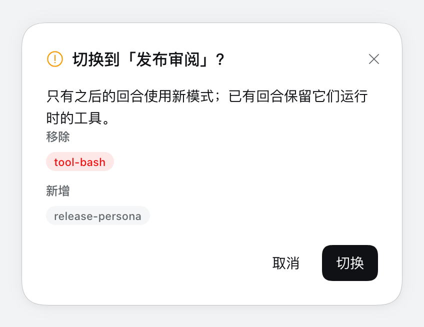

# dsh-preset-switch

[English](README.md)

在会话空闲时，点击标题栏当前预设名旁滑出的箭头，
或运行 `/preset-switch <preset-id>`（中文输入 `/` 可选 `/切换预设 standard`）切换 Agent 模式。
纯新增插件行的切换直接生效；会移除或停用当前已有插件行的切换将先弹出确认框。

仅在会话空闲（无进行中回合或压缩）时可用；历史回合保留原样，由目标模式不再挂载的插件所持有的 goal、计划、
后台任务、终端与子代理不会自动停止或迁移。

需要 DeepSeek Harness `0.2.2-rc.5` 或更新版本。可在 **会话模块化改良计划** 中直接开启 **切换会话模式**，
或在源码目录运行 `pnpm install --frozen-lockfile` 后从 **插件 → 添加插件** 选择本目录（或用 `install_bundle` 安装）。

## 界面截图

- 模式列表 · [浅色](docs/assets/screenshots/entry-light.png) · [深色](docs/assets/screenshots/entry-dark.png)
- 切换确认 · [浅色](docs/assets/screenshots/main-light.png) · [深色](docs/assets/screenshots/main-dark.png)

[项目文档](docs/README.md)
